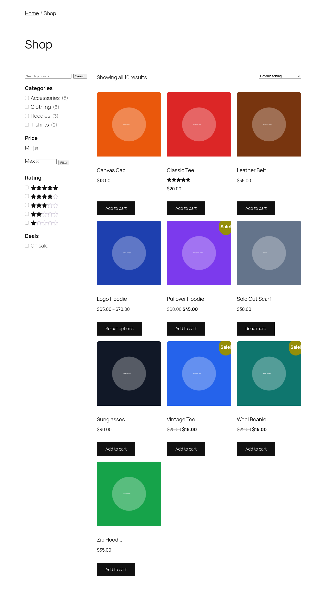
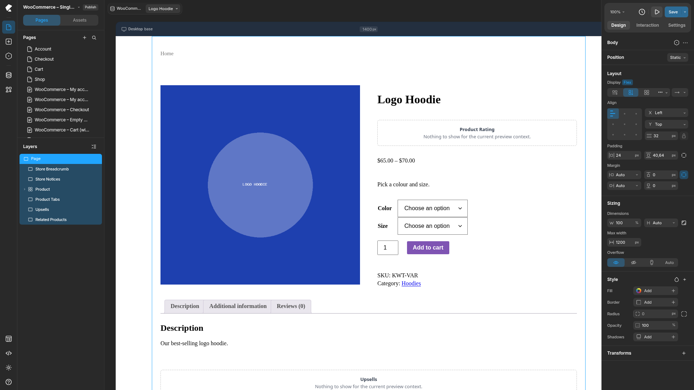
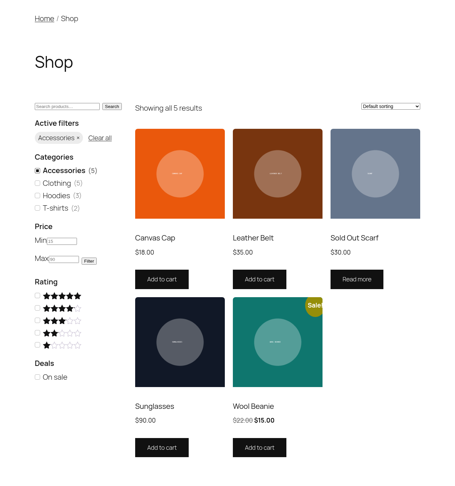
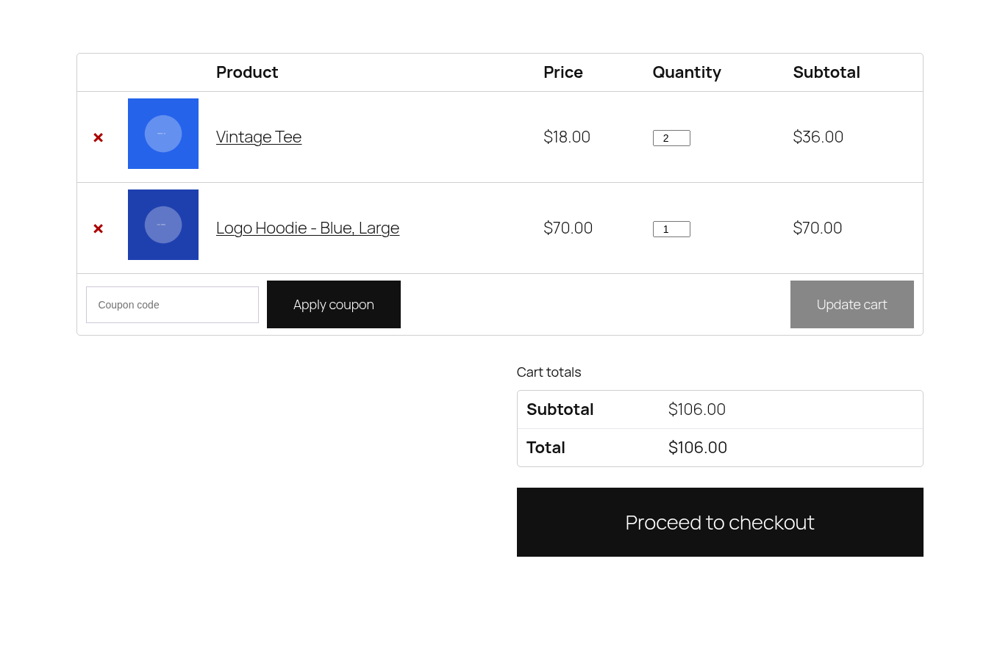
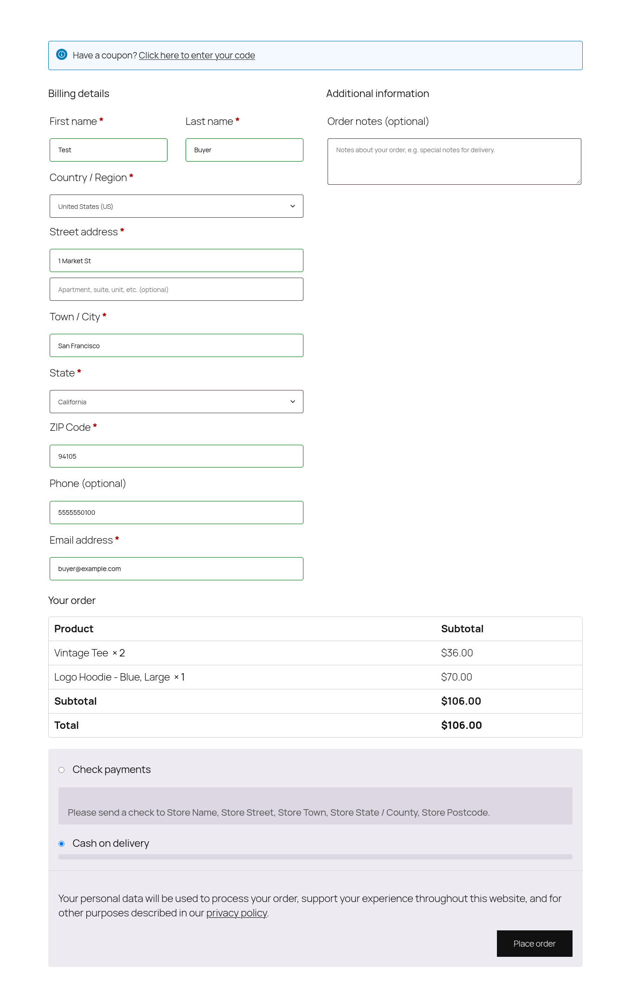
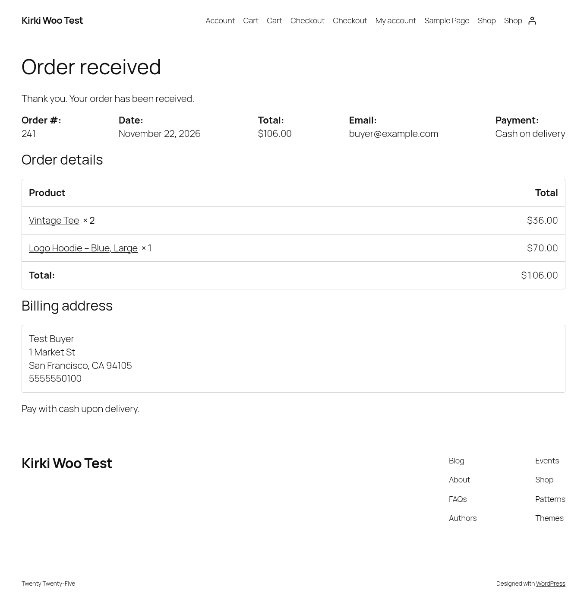
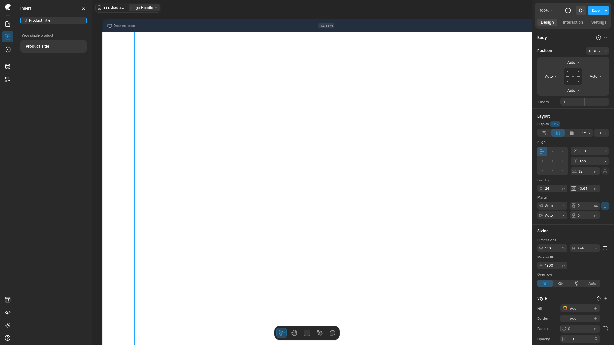

# Kirki WooCommerce Bridge

**Design a complete WooCommerce store in the [Kirki](https://wordpress.org/plugins/kirki/) visual builder, with WooCommerce doing the selling.**

Kirki WooCommerce Bridge gives Kirki and Kirki Pro users native builder elements, dynamic product data and template rules for every WooCommerce page: shop, product, cart, checkout and account. Everything is backed by WooCommerce itself, so your payment gateways, shipping, taxes, subscriptions, memberships and other extensions keep working.

You can use it **instead of Kirki eCommerce**: it covers the same storefront building blocks on top of WooCommerce. It also **runs safely next to Kirki eCommerce** if you keep both installed.

- 36 Kirki elements covering single product parts, product grids, shop filters, sorting and pagination, mini cart, cart, checkout, my account, notices, breadcrumbs and order tracking.
- Starter layouts for each WooCommerce page, plus template rules that assign them by product, category, tag, type, stock, sale state, archive term, account endpoint or sign-in state.
- 33 product fields and 11 store fields as Kirki dynamic content, plus a `[kirki_woo]` shortcode.
- WooCommerce data sources for Kirki's native **Collection** element: related, upsells, cross-sells, cart items, featured, on sale, best selling, top rated and recently viewed. You can design your own product cards with dynamic data.
- A documented **REST API and WordPress Abilities API** with 21 operations, so AI agents and the Kirki MCP can build stores ([docs/API.md](docs/API.md)).
- HPOS compatible. Works with the classic or block cart and checkout. i18n ready, WPCS clean, GPL-2.0-or-later.



## Why a bridge?

Kirki 6 is a freeform page builder. Its own store plugin, **Kirki eCommerce**, is a separate shop system with its own catalogue, orders, payments and tables. If your store already runs on WooCommerce, or you need WooCommerce's ecosystem, Kirki has no WooCommerce elements: Kirki 6.4.3's only WooCommerce reference is a changelog fix for catalogue product titles. See [docs/RESEARCH.md](docs/RESEARCH.md) for the findings.

The bridge fills that gap. It connects Kirki's editor (elements, dynamic content, templates) to WooCommerce's data and templates.

### Kirki eCommerce vs. Kirki WooCommerce Bridge

| Storefront feature | Kirki eCommerce 1.0.2 | Kirki WooCommerce Bridge |
|---|---|---|
| Product catalogue, variants, inventory | Kirki eCommerce tables | WooCommerce products (simple, variable, grouped, external, plus extension types) |
| Shop / archive page | Built-in page with sidebar, breadcrumb and cards | **Products Grid** (10 sources, responsive columns, card or WooCommerce loop layout), **Result Count**, **Sorting**, **Pagination**, **Archive Title/Description**, **Category Grid**, **Product Search** |
| Shop filters | Sidebar filters | **Product Filter** (categories, price, rating, stock, on sale, any attribute; active filters) applied to the main WooCommerce query |
| Single product | Built-in template | 18 elements: title, price, image, gallery (zoom, lightbox, slider), add to cart (all product types and variations), stock, rating, short/long description, meta, SKU, categories/tags/brands, tabs, additional information, reviews, related, upsells, sale badge |
| Cart | Built-in page | **Cart** (classic or block), **Cart Totals**, **Cross-sells**, empty-cart template |
| Checkout | Built-in page | **Checkout** (classic or block, so every WooCommerce gateway works), order-received template |
| Mini cart | `[kecom_mini_cart]` shortcode and block | **Mini Cart** element (live count and total, drawer or link, auto-open on add to cart), `[kirki_woo_mini_cart]`, and `[kecom_mini_cart]` served from WooCommerce when Kirki eCommerce is not active |
| Account | Dashboard, orders, addresses, details, wishlist | **My Account** (all WooCommerce endpoints, with per-endpoint rules), sign-in/register template, **Order Tracking** |
| Dynamic data | Not available in Kirki dynamic content | 33 product and 11 store fields in Kirki dynamic content, and WooCommerce collections for Kirki's Collection element |
| Payments, shipping, taxes, coupons, emails, analytics | Built in | WooCommerce core plus its extension ecosystem |
| Wishlist, currency switcher | Built in | Not included; use any WooCommerce wishlist or multi-currency extension |
| AI / MCP automation | — | REST and Abilities API (21 operations), including creating designs and inserting elements |

## Requirements

- WordPress 6.5+ (the Abilities API is used when available, e.g. WordPress 6.9+)
- PHP 7.4+
- WooCommerce 8.0+ (tested with 11.3)
- Kirki 6.0+ (tested with Kirki 6.4.3 free and Kirki Pro 6.4.3; Pro is optional)

Kirki eCommerce is **not** required.

## Installation

1. Download `kirki-woocommerce-bridge-1.0.0.zip` from the [latest release](https://github.com/saaduddinsony/kirki-woocommerce-bridge/releases/latest).
2. In WordPress, go to **Plugins → Add New → Upload Plugin**, then install and activate it. WooCommerce and Kirki must be active.
3. Go to **WooCommerce → Kirki Templates**. Click **Create design** for a context (for example *Single product*), then open it in Kirki. It starts from a ready-made layout.

## Using it

### Elements in the Kirki editor

Open any Kirki page or template. In the **Insert** panel, search for an element by name (for example *Product Title* or *Products Grid*). You can also turn on **View → Show base elements** to browse the *Woo single product*, *Woo shop & archives*, *Woo cart & checkout*, *Woo account* and *Woo general* categories. Elements preview live in the canvas with real store data. Product elements use the product being edited, or the preview product from the settings.



### Template rules

**WooCommerce → Kirki Templates** lists the rules that pick a Kirki design for each WooCommerce context:

| Context | Example conditions |
|---|---|
| Single product | products, excluded products, categories, tags, product type, stock status, on sale, featured, signed-in state |
| Shop page, product search | signed-in state |
| Product archives | taxonomy (category, tag, attributes), terms |
| Cart, empty cart, checkout, order received | signed-in state |
| My account (signed in) | endpoint (dashboard, orders, addresses …) |
| My account login / register | — |

The highest-priority matching rule wins, and ties go to the most specific rule. Native Kirki templates that already target a product or product archive win by default. To change this, turn off the `respect_kirki_native` setting on the same screen.

> **Save vs. Publish in Kirki:** Kirki's *Save* stores a draft stage. Use **Save → Publish** to make the design live.

### Dynamic data

Bind text and links to fields such as `price_html`, `sku`, `stock_status`, `discount_percentage`, `cart_count` or `free_shipping_remaining`. You can do this in Kirki's dynamic content picker (*Product (WooCommerce)* and *Store (WooCommerce)* types) or with the `[kirki_woo field="price_html" product_id="0"]` shortcode. Product images are available through the Product Image and Product Gallery elements and the `image_url` link field.

### Shortcodes

| Shortcode | Purpose |
|---|---|
| `[kirki_woo_element name="products" columns="3" limit="6"]` | Render any element outside Kirki (attributes are element settings) |
| `[kirki_woo_mini_cart behavior="drawer"]` | Mini cart anywhere (header, widget, menu) |
| `[kirki_woo field="sku" product_id="0"]` | One dynamic field |
| `[kecom_mini_cart]` | Kirki eCommerce's mini cart shortcode, served from WooCommerce **only when Kirki eCommerce is not active** (helps sites switching over) |

## Running next to Kirki eCommerce

Both plugins can be active at the same time:

- **Everything is namespaced:** elements `kirki-woo-*`, CSS `kwi-*`, shortcodes `kirki_woo*`, options `kirki_woo_*`, REST `kirki-woo/v1`, abilities `kirki-woo/*` and PHP namespace `KirkiWoo\`. Kirki eCommerce uses `kecom*` / `kirki_ecommerce*`. Nothing is shared or overridden. Kirki eCommerce keeps its own `[kecom_*]` shortcodes, pages and catalogue.
- **Page conflicts are detected:** if one WordPress page is set as both a Kirki eCommerce page and a WooCommerce page, the Kirki Templates screen warns you. The status endpoint also reports it.
- **A Kirki eCommerce script clash is fixed:** Kirki eCommerce 1.0.2's storefront script replaces the global `_` (Underscore). That breaks WooCommerce variable products: no variation price, and the product can't be added to the cart. When Kirki eCommerce is active, the bridge restores the missing Underscore helpers without touching Kirki eCommerce's own data. You can disable this with `add_filter( 'kirki_woo_underscore_compat', '__return_false' )`.

The compatibility matrix in [docs/TESTING.md](docs/TESTING.md) covers WooCommerce only, WooCommerce + Kirki eCommerce, and each with or without Kirki Pro.

## API for AI agents and the Kirki MCP

All features are available through one operation table, exposed two ways:

- **REST**: `/wp-json/kirki-woo/v1/...` (cookie + nonce or application passwords)
- **WordPress Abilities API**: `kirki-woo/<operation>` abilities in the `kirki-woo` category, with input schemas and `readonly` / `destructive` / `idempotent` annotations

Operations: `get-status`, `list-elements`, `get-element`, `render-element`, `build-block`, `list-dynamic-fields`, `resolve-dynamic-field`, `get-settings`, `update-settings`, `list-template-contexts`, `list-templates`, `create-template`, `get-template`, `update-template`, `delete-template`, `resolve-template`, `list-designs`, `create-design`, `get-design`, `add-design-elements`, `delete-design`.

See **[docs/API.md](docs/API.md)** for routes, schemas, permissions, errors and an MCP tool mapping.

## Screenshots

| Shop with filters | Single product |
|---|---|
|  |  |
| **Cart** | **Checkout** |
|  |  |
| **Order received** | **Kirki Insert panel** |
|  |  |

## Development

```bash
composer install && npm ci
bin/setup-test-site.sh ../kirki-woo-site          # WordPress + SQLite + WooCommerce + Kirki on http://127.0.0.1:8895
vendor/bin/phpcs                                   # WordPress Coding Standards
KIRKI_WOO_WP_LOAD=../kirki-woo-site/site/wp-load.php vendor/bin/phpunit
npx playwright test                                # E2E (set CHROME_PATH to use a local Chrome)
tests/bin/matrix.sh ../kirki-woo-site http://127.0.0.1:8895 "my combo"
bin/build-zip.sh                                   # build/kirki-woocommerce-bridge-<version>.zip
```

The test site script installs a brand-new local WordPress. Never point it at a real site. More in [docs/TESTING.md](docs/TESTING.md).

## Hooks

Filters: `kirki_woo_elements`, `kirki_woo_element_html`, `kirki_woo_render_element_{slug}`, `kirki_woo_dynamic_product_fields`, `kirki_woo_dynamic_store_fields`, `kirki_woo_dynamic_product_{field}`, `kirki_woo_dynamic_store_{field}`, `kirki_woo_matched_template`, `kirki_woo_design_post_types`, `kirki_woo_operations`, `kirki_woo_canvas_styles`, `kirki_woo_underscore_compat`, `kirki_woo_kecom_shortcode_aliases`.
Actions: `kirki_woo_loaded`, `kirki_woo_template_applied`.

## License

GPL-2.0-or-later. Copyright © 2026 S M Saad Uddin. See [LICENSE](LICENSE).

Kirki, Kirki Pro and Kirki eCommerce are products of Themeum. WooCommerce is a trademark of Automattic. This is an independent project and is not affiliated with either.
